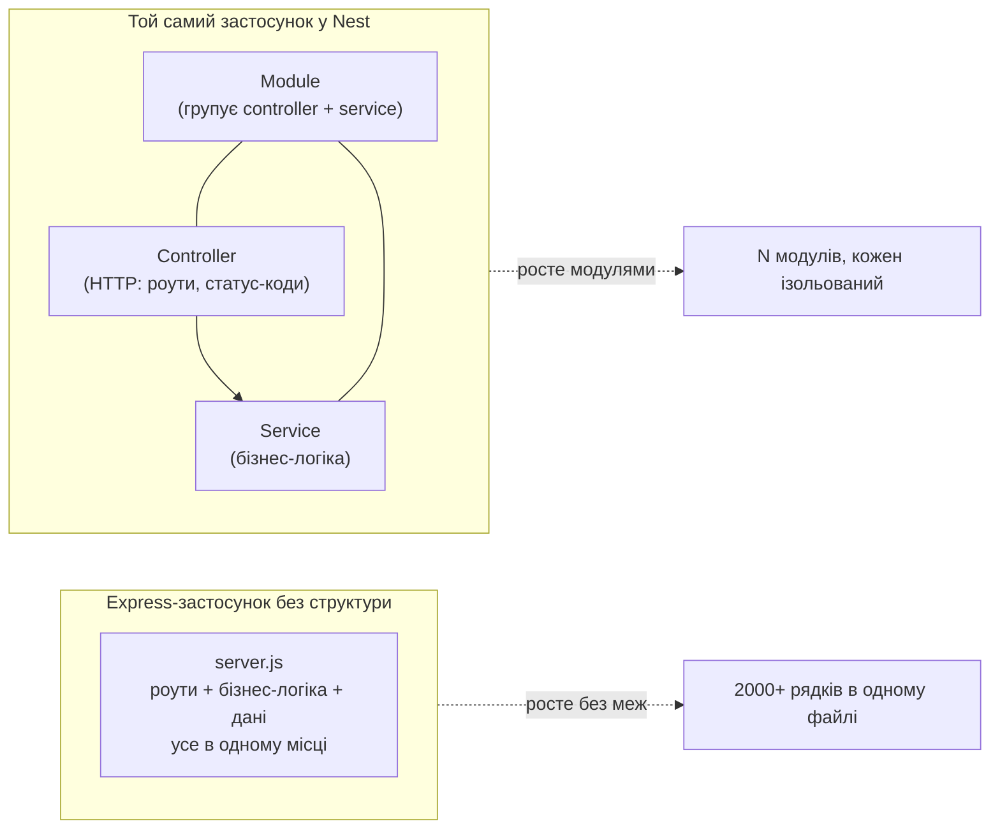

# 00. Чому Nest

## 1. Мета

Після цієї теми студент зможе:

- назвати 3-4 конкретні проблеми, які виникають у великих Express-застосунках без додаткової структури;
- пояснити своїми словами, що таке Nest ("opinionated-фреймворк поверх Express/Fastify");
- пояснити, чому Nest написаний на TypeScript і чому це свідомий вибір, а не випадковість;
- сказати, коли варто брати Nest, а коли це overkill.

## 2. Таймінг на уроці

| Хвилини | Що показуємо |
|---|---|
| 0-10 | Відкриваємо `express-app/server.js` наживо, читаємо код, рахуємо дублювання |
| 10-25 | Теорія: що таке Nest, опінірованість, TypeScript, коли обирати |

## 3. Теорія

### 3.1. Проблема росту

Маленький Express-застосунок — це чудово: мінімум коду, максимум контролю,
нічого не заважає. Проблема виникає не на 50 рядках, а на 5000: Express
навмисно **не каже вам**, як організувати код. Він дає тільки `app.get()`,
`app.post()` і middleware — все інше (структура папок, де лежить бізнес-логіка,
як передавати залежності, як тестувати) команда вигадує сама.

Коли команда з 5 розробників кожен вигадує "сама" — вони вигадують по-різному.
Результат — `server.js` на 00-express-app, але помножений у 100 разів.

### 3.2. Що таке Nest

**Nest (NestJS)** — це **opinionated-фреймворк** (框架 "з думкою") для Node.js,
побудований **поверх Express** (за замовчуванням) або **Fastify** (опціонально).
"Opinionated" означає: Nest вже прийняв за вас купу рішень:

- де лежить бізнес-логіка (сервіси), а де — обробка HTTP (контролери);
- як один клас отримує залежність від іншого (Dependency Injection);
- як групувати пов'язаний код (модулі);
- яка структура папок у проєкті "за замовчуванням" (`nest new`).

Це не магія і не інший рушій — під капотом Nest на кожен HTTP-запит
зрештою викликає той самий Express, який ви вже знаєте. Nest — це шар
архітектури й угод **над** ним.



### 3.3. Чому TypeScript

Nest активно використовує **декоратори** (`@Controller()`, `@Injectable()`,
`@Module()`) і **метадані типів** для Dependency Injection — Nest дивиться
на тип параметра конструктора, щоб зрозуміти, яку залежність підставити.
Це технічно можливо тільки з TypeScript (детальніше — у темі
[01-typescript-and-decorators](../01-typescript-and-decorators/README.md)).
JavaScript-проєкт на Nest теж можливий, але втрачає половину зручностей.

### 3.4. Коли обирати Nest, а коли ні

**Обирати Nest, коли:**
- застосунок росте і буде підтримуватись кількома людьми довго;
- потрібна чітка архітектура "з коробки" (enterprise API, мікросервіси);
- команда готова писати TypeScript і дотримуватись угод Nest.

**НЕ обирати Nest, коли:**
- це маленький скрипт, лямбда-функція або прототип на вихідні;
- команда з 1-2 людей, яким не потрібна жорсткість структури;
- критична мінімальна кількість залежностей і холодний старт (serverless edge).

## 5. Розбір коду

Файл [`express-app/server.js`](./express-app/server.js) — API бібліотеки:
`GET/POST/PUT/DELETE /books`, дані в масиві в пам'яті. Прочитайте його
наживо на уроці й знайдіть разом зі студентами коментарі `[ПРОБЛЕМА]`:

- перевірка `Number(req.params.id)` + `Number.isNaN` скопійована **3 рази**;
- валідація `title`/`author`/`year` скопійована **2 рази**;
- "база даних" — глобальний масив `books`, який мутує будь-яка функція;
- HTTP (статус-коди) і бізнес-логіка (що означає "створити книжку")
  живуть в одній і тій же функції-колбеку.

Це вже помітно на 140 рядках. На реальному проєкті з 15 ресурсами
замість одного — такого коду буде в 15 разів більше, і кожна копія
валідації буде трохи відрізнятись від інших.

## 6. Express vs Nest

| | Express | Nest |
|---|---|---|
| Структура проєкту | Не визначена, кожен вирішує сам | Контролери / Сервіси / Модулі "з коробки" |
| Залежності між класами | Ручний імпорт і створення (`new Service()`) | Dependency Injection (Nest сам створює і підставляє) |
| Мова | JavaScript (TypeScript опціонально) | TypeScript "з коробки" |
| Маршрутизація | `app.get('/path', handler)` | Декоратори `@Get('path')` на методах класу |
| Що під капотом | Сам є HTTP-рушієм | Express або Fastify (ви обираєте) |
| Крива навчання | Низька на старті | Вища на старті, нижча на масштабі |

Код далі в темі [03-controllers](../03-controllers/README.md) покаже ці ж
ендпоінти `/books`, написані і на Express, і на Nest — поруч.

## 7. Як запустити

```bash
# з кореня репозиторію (після npm install в корені)
npm run start:00

# або напряму
cd 00-why-nest/express-app
npm install
npm start
```

Застосунок піднімається на `http://localhost:3000`.

### curl-приклади

```bash
curl http://localhost:3000/books
curl http://localhost:3000/books/1
curl -X POST http://localhost:3000/books \
  -H "Content-Type: application/json" \
  -d '{"title":"Інтернат","author":"Сергій Жадан","year":2017}'
```

Повний список запитів — у [`express-app/requests.http`](./express-app/requests.http).

## 8. Типові помилки

- **`Error: Cannot find module 'express'`** — забули `npm install` у
  `00-why-nest/express-app` (або в корені, якщо встановлюєте через workspaces).
- **`EADDRINUSE: address already in use :::3000`** — порт 3000 уже зайнятий
  іншим застосунком (можливо, попереднім запуском цього ж сервера, який
  не зупинили). Знайдіть і зупиніть процес або змініть `PORT` у `server.js`.
- **Тіло запиту приходить як `undefined`** — забули `app.use(express.json())`
  (у нашому файлі воно є, але це найчастіша причина такого бага загалом).

## 9. Питання для самоперевірки

1. Що означає "opinionated" стосовно фреймворку?
   <details><summary>Відповідь</summary>Фреймворк, який вже прийняв за вас архітектурні рішення (структура папок, спосіб передачі залежностей, групування коду), а не дає повну свободу, як "чистий" Express.</details>

2. Nest замінює Express чи працює поверх нього?
   <details><summary>Відповідь</summary>Працює поверх нього (за замовчуванням) або поверх Fastify. Під капотом HTTP-запити все одно обробляє один з цих двох рушіїв.</details>

3. Чому в `server.js` з теми 00 перевірка `id` на число зустрічається кілька разів?
   <details><summary>Відповідь</summary>Тому що в "чистому" Express немає стандартного механізму (як Pipes у Nest) для повторного використання такої логіки між роутами — кожен роут пише її заново.</details>

4. Чи можна писати на Nest без TypeScript?
   <details><summary>Відповідь</summary>Технічно можна (JavaScript + декоратори через Babel), але це нестандартний і незручний шлях. 99% проєктів на Nest — TypeScript.</details>

5. Назвіть одну ситуацію, де Express без Nest — краще рішення.
   <details><summary>Відповідь</summary>Наприклад, маленька serverless-функція з однією ручкою, де важливий мінімальний холодний старт і де архітектурна жорсткість Nest не дає переваг.</details>

## 10. Практика

Окремої папки `exercises/` для цієї теми немає — вона суто теоретична.
Швидка вправа прямо зараз: відкрийте `express-app/server.js` і знайдіть
ще одне місце, де один і той же шматок логіки написаний двічі (підказка:
гляньте уважно на формат помилок `{ message: ... }`).

## 11. Корисні посилання

- [NestJS — First steps](https://docs.nestjs.com/first-steps) — офіційний вступ, що таке Nest
- [NestJS — official documentation](https://docs.nestjs.com/) — головна сторінка документації
- [Express — Getting started](https://expressjs.com/en/starter/installing.html) — для нагадування, як виглядає "чистий" Express
- [Wikipedia — Convention over configuration](https://en.wikipedia.org/wiki/Convention_over_configuration) — близький за змістом принцип, що лежить в основі "opinionated"-підходу
