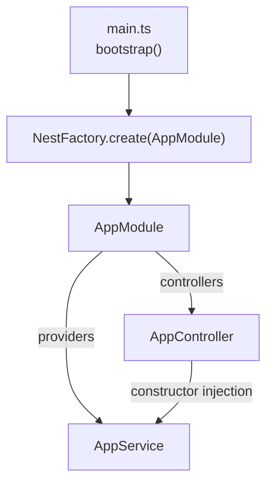

# 02. Перший Nest-застосунок

## 1. Мета

Після цієї теми студент зможе:

- згенерувати новий Nest-застосунок командою `nest new`;
- пояснити призначення кожного файлу в структурі проєкту;
- запустити застосунок і пояснити, що відбувається в `main.ts`.

## 2. Таймінг на уроці

| Хвилини | Що показуємо |
|---|---|
| 40-45 | Наживо: `nest new`, дивимось, що згенерувалось |
| 45-50 | Розбір файлів: `main.ts`, `app.module.ts`, `app.controller.ts`, `app.service.ts` |
| 50-55 | Запуск, перший запит у браузері/curl/REST Client |

## 3. Теорія

Nest CLI (`@nestjs/cli`) - це генератор проєктів і код-генератор
(схожий на `ng` в Angular, якщо хтось знайомий). Команда
`nest new <ім'я>` створює мінімальний робочий застосунок зі структурою,
яку команда Nest вважає стандартною.

### Мінімальний граф застосунку



## 4. Що змінилось порівняно з попередньою темою

Це перший Nest-код у проєкті - порівнюємо не з попередньою темою,
а з тим, що `nest new app` згенерував "із коробки".

### Що прибрано зі згенерованого проєкту і чому

Команда `nest new` (версія CLI 12.x) за замовчуванням додає інструменти,
які не потрібні на вступному уроці, але варто знати, що вони існують
у реальних проєктах:

| Що прибрано | Навіщо воно в реальному проєкті |
|---|---|
| `src/app.controller.spec.ts`, `test/app.e2e-spec.ts` | Юніт- і e2e-тести. У реальному проєкті - обов'язкові, тут відволікають від теми Nest. |
| `vitest.config.ts`, `vitest.config.e2e.ts` | Налаштування тест-раннера Vitest (сучасний дефолт Nest CLI замість Jest). |
| `oxlint.json` | Конфігурація лінтера `oxlint` (сучасний дефолт замість ESLint) - шукає проблеми в коді ще до запуску. |
| `@nestjs/mau` у `devDependencies` | CLI-інтеграція з хмарним деплоєм Nest (Mau) - не потрібна для локального навчання. |
| Власний `.prettierrc` і `README.md` застосунку | Залишаємо єдиний `.prettierrc` в корені репозиторію на всі теми. |

### ESM → CommonJS: свідома зміна

Згенерований `nest new` проєкт за замовчуванням - **ESM-модуль**
(у `package.json` стоїть `"type": "module"`, а імпорти виглядають як
`import { AppModule } from './app.module.js'` - зверніть увагу на
`.js` у кінці, хоча файл `.ts`). Це сучасний стандарт Node.js, і саме
так сьогодні виглядає код на [офіційних прикладах Nest](https://docs.nestjs.com/first-steps).

У цьому репозиторії ми **свідомо перемикаємо застосунок на CommonJS**
(`"module": "commonjs"` у `tsconfig.json`, без `"type": "module"` у
`package.json`, без `.js` у кінці імпортів TS-файлів). Причина проста:
ви й так слабо знаєте TypeScript, а ESM додає окрему тему для
обговорення (чому `.js`, якщо файл `.ts`? що таке top-level await?),
яка не стосується Nest. Коли освоїтесь із Nest - ESM-варіант не
складе проблем, різниця лише в оформленні імпортів.

## 5. Розбір коду

- **`src/main.ts`** - точка входу. `NestFactory.create(AppModule)`
  читає кореневий модуль і піднімає HTTP-сервер (Express під капотом).
- **`src/app.module.ts`** - кореневий модуль, `@Module({...})` з трьома
  секціями: `imports`, `controllers`, `providers`.
- **`src/app.controller.ts`** - один контролер з одним маршрутом
  `GET /`, інжектує `AppService`.
- **`src/app.service.ts`** - один сервіс з однією бізнес-логікою:
  повернути рядок привітання.
- **`nest-cli.json`** - налаштування самого CLI (де лежить код, що
  видаляти перед збіркою).
- **`tsconfig.json`/`tsconfig.build.json`** - налаштування компілятора;
  `tsconfig.build.json` додатково каже "не включай `*.spec.ts` у збірку".

## 6. Express vs Nest

| | Express (тема 00) | Nest (ця тема) |
|---|---|---|
| Запуск сервера | `app.listen(PORT)` напряму в `server.js` | `app.listen(PORT)` всередині `bootstrap()`, але сам `app` зібраний з модуля |
| Де маршрут `/` | `app.get('/', handler)` | `@Get()` на методі `AppController` |
| Де "привіт" текст | Прямо в колбеку роута | В окремому `AppService`, контролер лише звертається до нього |

## 7. Як запустити

```bash
# з кореня репозиторію
npm install
npm run start:02

# або напряму
cd 02-first-nest-app/app
npm install
npm run build
node dist/main
# або без збірки, у режимі розробки з автоперезапуском:
npm run start:dev
```

Застосунок піднімається на `http://localhost:3002`.

```bash
curl http://localhost:3002/
```

Повний (один) запит - у [`requests.http`](./requests.http).

## 8. Типові помилки

- **`Nest can't resolve dependencies of the AppController (?)`** - сервіс
  не додано в `providers` модуля, або контролер не бачить потрібний
  модуль. У нас такого немає, але це найчастіша помилка Nest загалом -
  запам'ятайте формулювання, воно буде зустрічатись у темі 04-05.
- **`Cannot find module './app.module'`** - переплутали CommonJS/ESM:
  якщо в імпорті раптом з'явиться `.js` на кінці шляху при
  `"module": "commonjs"`, Node шукатиме буквально файл `app.module.js`,
  якого немає (є лише скомпільований `dist/app.module.js`, а в `src/`
  лежить `.ts`).
- **`EADDRINUSE: address already in use :::3002`** - порт зайнятий
  попереднім запуском цього ж застосунку.

## 9. Питання для самоперевірки

1. Що робить `NestFactory.create(AppModule)`?
   <details><summary>Відповідь</summary>Будує застосунок: читає AppModule і все, що він імпортує/реєструє, створює HTTP-сервер (Express/Fastify) і повертає об'єкт застосунку, готовий до `listen()`.</details>

2. Чому `AppController` не створює `AppService` сам (`new AppService()`)?
   <details><summary>Відповідь</summary>Бо Nest сам створює екземпляр AppService і підставляє його через конструктор - це Dependency Injection, докладно в темі 04.</details>

3. Навіщо окремий `tsconfig.build.json`, якщо вже є `tsconfig.json`?
   <details><summary>Відповідь</summary>Щоб при збірці (`nest build`) виключити тестові файли (`*.spec.ts`) і папку `test/` - вони не повинні потрапляти в `dist/`.</details>

4. Який тип модулів (ESM чи CommonJS) використовує ця тема - і чому це відрізняється від того, що генерує `nest new` сьогодні?
   <details><summary>Відповідь</summary>CommonJS, свідомо замість дефолтного ESM - щоб не додавати до теми Nest ще й тему "особливості ESM-імпортів" для студентів, слабких у TypeScript.</details>

## 10. Практика

Для цієй теми окремої папки `exercises/` немає - перше домашнє
завдання чекає у [`../HOMEWORK.md`](../HOMEWORK.md). Швидка вправа
зараз: зміна тексту, який повертає `AppService.getHello()`, і
перезапуск застосунку.

## 11. Корисні посилання

- [NestJS - First steps](https://docs.nestjs.com/first-steps)
- [NestJS - CLI overview](https://docs.nestjs.com/cli/overview)
- [NestJS - CLI usages (nest new)](https://docs.nestjs.com/cli/usages)
- [TypeScript - tsconfig reference](https://www.typescriptlang.org/tsconfig/)
