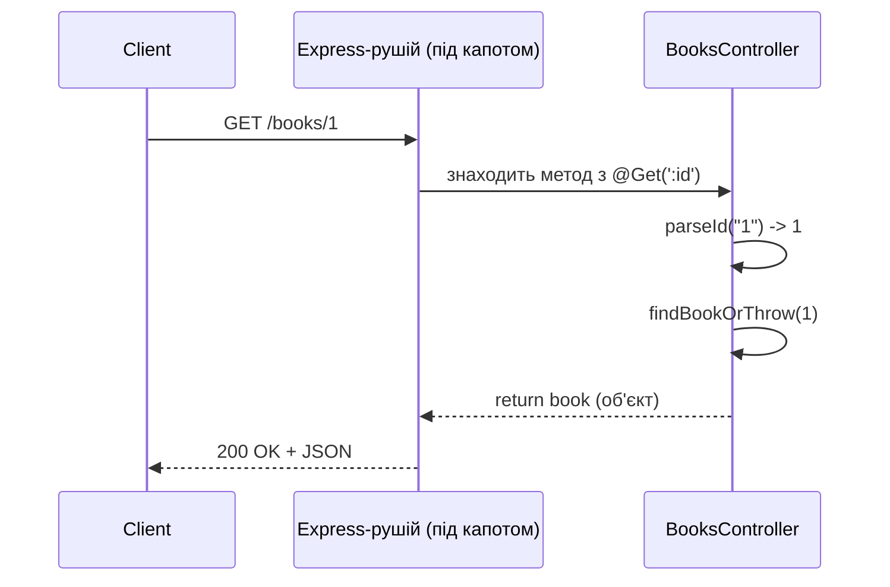

# 03. Controllers: Express-роут ↔ Nest Controller

## 1. Мета

Після цієї теми студент зможе:

- пояснити відповідність `app.get/post/put/delete` та декораторів `@Get/@Post/@Put/@Delete`;
- використовувати `@Param`, `@Query`, `@Body` для читання даних запиту;
- пояснити, чому в Nest не треба писати `res.json(...)` вручну;
- читати й писати прості DTO-класи для тіла запиту.

## 2. Таймінг на уроці

| Хвилини | Що показуємо |
|---|---|
| 65-70 | Відкриваємо `express-version/server.js` - нагадуємо, як виглядають роути |
| 70-85 | Той самий API в `nest-version/src/books/books.controller.ts`, рядок за рядком |
| 85-100 | Live-coding: додаємо студентам приклад з `@Query` |

## 3. Теорія

Контролер у Nest - це клас, позначений `@Controller(префікс)`, методи
якого позначені `@Get()`, `@Post()`, `@Put()`, `@Delete()` (і ще
`@Patch()`, `@Options()` тощо). Кожен такий метод - це один "роут",
еквівалент одного `app.get(path, handler)` в Express.

Головна відмінність не в можливостях (можна зробити все те саме), а
в **способі оголошення**: замість викликати функцію `app.get(...)` і
передавати їй шлях і колбек, ми описуємо шлях і метод **декоратором
над методом класу**, а Nest сам, під час старту застосунку, читає ці
декоратори й будує таблицю маршрутів.



## 4. Що змінилось порівняно з попередньою темою

У темі 02 був один контролер з одним маршрутом "для перевірки". Тут -
повноцінний `BooksController` з п'ятьма маршрутами і DTO для тіла
запиту. Сервісів і Dependency Injection ще немає (`providers: []`) -
уся логіка тимчасово живе в контролері, так само, як і в
Express-версії. Це зроблено свідомо: у темі 04 ми побачимо, чому
таке змішування стає проблемою, і винесемо логіку в сервіс.

## 5. Розбір коду

- **`nest-version/src/books/book.interface.ts`** - форма однієї книжки.
- **`nest-version/src/books/dto/create-book.dto.ts`**,
  **`update-book.dto.ts`** - форма тіла запиту для POST і PUT, без валідації.
- **`nest-version/src/books/books.controller.ts`** - п'ять маршрутів:
  - `@Get()` + `@Query('author')` - список з необов'язковим фільтром;
  - `@Get(':id')` + `@Param('id')` - одна книжка;
  - `@Post()` + `@Body()` - створення;
  - `@Put(':id')` - оновлення;
  - `@Delete(':id')` + `@HttpCode(204)` - видалення.
- **`express-version/server.js`** - той самий API на "чистому" Express,
  рядок у рядок відповідає Nest-версії для порівняння.

## 6. Express vs Nest

| Що треба зробити | Express | Nest |
|---|---|---|
| Оголосити маршрут | `app.get('/books/:id', (req, res) => {...})` | `@Get(':id')` на методі класу |
| Прочитати параметр URL | `req.params.id` | `@Param('id') id: string` як аргумент методу |
| Прочитати query-рядок | `req.query.author` | `@Query('author') author?: string` |
| Прочитати тіло запиту | `req.body` (потрібен `express.json()`) | `@Body() dto: CreateBookDto` (парсинг вже вбудований) |
| Повернути JSON зі статусом 200 | `res.json(data)` | `return data;` - Nest сам серіалізує й ставить статус |
| Повернути 404 | `res.status(404).json({...})` | `throw new NotFoundException('...')` |
| Повернути 201 для POST | `res.status(201).json(data)` | Нічого робити не треба - дефолт Nest для POST |
| Повернути 204 | `res.status(204).send()` | `@HttpCode(204)` над методом |

## 7. Як запустити

```bash
# з кореня репозиторію, два окремі терміналі
npm run start:03            # nest-version, http://localhost:3003
npm run start:03:express     # express-version, http://localhost:3103
```

```bash
curl http://localhost:3003/books
curl http://localhost:3103/books
curl "http://localhost:3003/books?author=Шевченко"
curl -X POST http://localhost:3003/books -H "Content-Type: application/json" \
  -d '{"title":"Інтернат","author":"Сергій Жадан","year":2017}'
```

Повний список - у [`requests.http`](./requests.http) (пари запитів nest/express поруч).

## 8. Типові помилки

- **`Cannot GET /books/1` на Nest-версії** - контролер не додано в
  `controllers` модуля (`app.module.ts`).
- **`@Body() dto` приходить як `{}`** - забули `Content-Type: application/json`
  у запиті (стосується і Express, і Nest - обидва парсять JSON лише
  з цим заголовком).
- **`GET /books/latest` повертає 400 "id має бути числом"** (зустрінете
  у вправах) - маршрут із конкретним текстом (`'latest'`) оголошено
  ПІСЛЯ маршруту з параметром (`:id`), і параметризований маршрут
  "перехопив" запит першим.
- **Порівнюючи відповіді nest/express, бачите різний порядок полів
  JSON** - це нормально, порядок полів об'єкта в JSON не гарантований
  і не має значення.

## 9. Питання для самоперевірки

1. Що робить декоратор `@Param('id')` у параметрі методу?
   <details><summary>Відповідь</summary>Дістає значення сегмента `:id` з URL маршруту (еквівалент `req.params.id` в Express).</details>

2. Чим `@Query` відрізняється від `@Param`?
   <details><summary>Відповідь</summary>`@Query` читає значення з query-рядка (`?key=value` після `?`), а `@Param` - з динамічного сегмента самого шляху (`:id`).</details>

3. Чи потрібно в Nest-контролері викликати `res.json()`, щоб повернути дані?
   <details><summary>Відповідь</summary>Ні, достатньо звичайного `return value` - Nest сам серіалізує результат у JSON і виставляє статус 200 (або 201 для POST).</details>

4. Чому в `BooksController` з теми 03 немає окремого сервісу?
   <details><summary>Відповідь</summary>Бо сервіси й Dependency Injection - тема наступного уроку (04); тут свідомо вся логіка лишається в контролері, щоб у темі 04 показати, навіщо її виносити.</details>

5. Що станеться, якщо зареєструвати `@Get('latest')` після `@Get(':id')` у тому самому контролері?
   <details><summary>Відповідь</summary>Запит `GET /books/latest` піде в обробник `:id`, бо рядок `'latest'` теж підходить під шаблон параметра - маршрут не дістанеться свого власного обробника.</details>

## 10. Практика

Завдання - у [`exercises/TASKS.md`](./exercises/TASKS.md), розв'язок -
у [`exercises/solutions/books.controller.solution.ts`](./exercises/solutions/books.controller.solution.ts).

## 11. Корисні посилання

- [NestJS - Controllers](https://docs.nestjs.com/controllers)
- [NestJS - Routing/Route parameters](https://docs.nestjs.com/controllers#route-parameters)
- [Express - Routing guide](https://expressjs.com/en/guide/routing.html)
- [MDN - HTTP response status codes](https://developer.mozilla.org/en-US/docs/Web/HTTP/Status)
