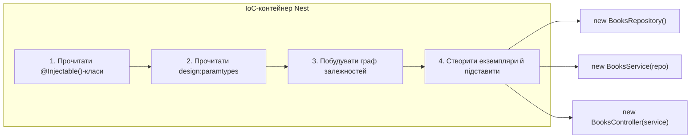

# 04. Сервіси, Dependency Injection, IoC-контейнер

## 1. Мета

Після цієї теми студент зможе:

- пояснити, навіщо виносити бізнес-логіку з контролера в сервіс;
- пояснити своїми словами, що таке Dependency Injection і IoC-контейнер;
- розповісти, як саме Nest дізнається, що й куди підставити (посилаючись
  на `design:paramtypes` з теми 01);
- розпізнати і виправити помилку `Nest can't resolve dependencies`.

## 2. Таймінг на уроці

| Хвилини | Що показуємо |
|---|---|
| 85-90 | Повертаємось до `BooksController` з теми 03: чому це проблема на масштабі |
| 90-95 | `di-from-scratch/` - пишемо контейнер за 30 рядків |
| 95-100 | `app/` - той самий API, тепер з `BooksService` |

## 3. Теорія

### 3.1. Навіщо окремий сервіс

У темі 03 весь код (дані, перевірки, бізнес-правила) жив прямо в
контролері. Це працює для одного ресурсу, але погано масштабується:

- контролер неможливо повторно використати логіку поза HTTP (наприклад,
  у фоновому завданні чи іншому контролері);
- тестувати бізнес-логіку окремо від HTTP (без піднімання сервера) незручно;
- контролер стає "і за все відповідальним" класом.

**Сервіс** - клас, що відповідає тільки за бізнес-логіку, без жодного
уявлення про HTTP. Контролер лише "перекладає" HTTP-запит у виклик
методу сервісу і повертає результат.

### 3.2. Що таке Dependency Injection (DI) і IoC

**Dependency Injection** - підхід, коли клас не створює свої залежності
сам (`new BooksService()`), а отримує їх готовими ззовні (зазвичай -
через параметри конструктора).

**IoC (Inversion of Control)** - "інверсія контролю": замість того,
щоб клас сам контролював, звідки беруться його залежності, цей
контроль передається комусь іншому (контейнеру). Nest має вбудований
**IoC-контейнер**, який на старті застосунку:

1. читає всі класи, позначені `@Injectable()` (провайдери);
2. для кожного читає типи параметрів конструктора (`design:paramtypes`
   з теми 01-typescript-and-decorators/src/04-metadata.ts);
3. будує граф залежностей і створює екземпляри в правильному порядку;
4. підставляє готові екземпляри в конструктори, де вони потрібні.



Це НЕ магія - у `di-from-scratch/container.ts` ми пишемо спрощену
версію саме цього контейнера (~30 рядків) і бачимо, що весь "секрет" -
це `Reflect.getMetadata('design:paramtypes', ...)` плюс рекурсія.

## 4. Що змінилось порівняно з попередньою темою

`BooksController` з теми 03 схуд до самого лише HTTP: параметри,
статус-коди, один виклик методу сервісу. Увесь масив `books`,
перевірки й бізнес-правила переїхали в новий `BooksService`
(позначений `@HttpCode(204)` лишився - це HTTP-деталь, вона
залишається в контролері). Модуль (`app.module.ts`) тепер реєструє
`BooksService` у `providers`.

## 5. Розбір коду

- **`di-from-scratch/container.ts`** - міні-контейнер: `Injectable()`
  (порожній маркер-декоратор) і `resolve()` (рекурсивне створення
  з кешем-синглтоном).
- **`di-from-scratch/index.ts`** - демонстрація: `BooksRepository`
  без залежностей, `BooksService`, що залежить від `BooksRepository`,
  і виклик `resolve(BooksService)` без жодного `new`.
- **`app/src/books/books.service.ts`** - `@Injectable()`-сервіс з
  усією логікою книжок.
- **`app/src/books/books.controller.ts`** - тонкий контролер, що
  інжектує `BooksService` і лише викликає його методи.
- **`app/src/app.module.ts`** - `providers: [BooksService]`.

## 6. Express vs Nest

| | Express (ручне розділення) | Nest |
|---|---|---|
| Хто створює сервіс | Розробник пише `const service = new BooksService()` | Nest створює сам, за графом залежностей |
| Де лежить "хто залежить від кого" | Ніде явно, тільки в голові розробника | У типах параметрів конструктора (`design:paramtypes`) |
| Підміна залежності для тестів | Вручну передати інший об'єкт в `new BooksController(fakeService)` | `overrideProvider()` у `@nestjs/testing` (поза межами цього уроку) |

## 7. Як запустити

```bash
# з кореня репозиторію
npm run start:04:di    # di-from-scratch - консольна демонстрація
npm run start:04        # Nest-застосунок, http://localhost:3004
```

```bash
curl http://localhost:3004/books
curl -X POST http://localhost:3004/books -H "Content-Type: application/json" \
  -d '{"title":"Інтернат","author":"Сергій Жадан","year":2017}'
```

Повний список - у [`requests.http`](./requests.http).

## 8. Типові помилки

- **`Nest can't resolve dependencies of the BooksController (?). Please make
  sure that the argument BooksService at index [0] is available in the
  AppModule context.`** - найчастіша помилка Nest. Причина в 95% випадків:
  сервіс не додано в `providers` модуля (або додано в інший модуль,
  не той, де оголошено контролер).
- **`TypeError: Cannot read properties of undefined`** під час виклику
  методу сервісу - перевірте, чи дійсно сервіс інжектовано через
  конструктор (`private readonly booksService: BooksService`), а не
  створено вручну (`new BooksService()`) - у ручному варіанті Nest
  нічого не підставляє, і якщо у сервіса є власні залежності, вони
  будуть `undefined`.
- **У `di-from-scratch` `Reflect.getMetadata('design:paramtypes', ...)`
  повертає `undefined`** - забули `@Injectable()` на класі з
  параметрами конструктора (детальніше - тема 01-metadata.ts).

## 9. Питання для самоперевірки

1. Що таке Inversion of Control своїми словами?
   <details><summary>Відповідь</summary>Контроль за створенням залежностей передається від самого класу комусь зовнішньому (контейнеру) - клас лише "просить" залежність через конструктор, а не створює її сам.</details>

2. Звідки IoC-контейнер Nest знає, які класи можна створювати?
   <details><summary>Відповідь</summary>З масиву `providers` модуля - лише класи, перелічені там (і позначені `@Injectable()`), контейнер готовий створювати й підставляти.</details>

3. Чому `BooksRepository` у `di-from-scratch/index.ts` не потребує декоратора `@Injectable()`, хоча `BooksService` потребує?
   <details><summary>Відповідь</summary>Декоратор потрібен лише для того, щоб TypeScript згенерував `design:paramtypes` для класу. У `BooksRepository` конструктор без параметрів - немає що генерувати, тож декоратор не впливає на результат.</details>

4. Що станеться, якщо зареєструвати сервіс у `providers`, але не передбачити його в конструкторі контролера?
   <details><summary>Відповідь</summary>Нічого поганого саме через це - сервіс просто не буде доступний у цьому контролері. Помилка `Nest can't resolve dependencies` виникає в протилежній ситуації: коли сервіс ОЧІКУЄТЬСЯ в конструкторі, але не зареєстрований.</details>

5. Чи може сервіс залежати від іншого сервіса (а не лише контролер - від сервіса)?
   <details><summary>Відповідь</summary>Так, саме так влаштований `BooksService` у вправах цієї теми - він залежить від `BooksRepository` і `BooksStatsService` тим самим механізмом конструктора.</details>

## 10. Практика

Завдання - у [`exercises/TASKS.md`](./exercises/TASKS.md), розв'язки -
у [`exercises/solutions/`](./exercises/solutions/).

## 11. Корисні посилання

- [NestJS - Providers](https://docs.nestjs.com/providers)
- [NestJS - Modules (providers)](https://docs.nestjs.com/modules)
- [Wikipedia - Dependency injection](https://en.wikipedia.org/wiki/Dependency_injection)
- [Wikipedia - Inversion of control](https://en.wikipedia.org/wiki/Inversion_of_control)
- [MDN - Reflect.getMetadata (reflect-metadata, GitHub)](https://github.com/microsoft/reflect-metadata)
